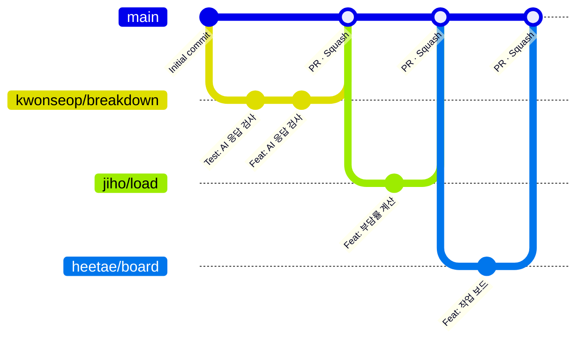

# 브랜치 · 커밋 가이드

> `main` 이 기본 브랜치입니다. 직접 push하지 않고 **작업 브랜치 + PR** 로만 바꿉니다.

## 브랜치 구조



## 작업 순서

```bash
git checkout main
```

```bash
git pull origin main
```

```bash
git checkout -b <이름>/<작업내용>
```

- 브랜치 이름 예: `kwonseop/breakdown` · `jiho/load` · `heetae/board`
- **브랜치 하나는 기능 하나.** 여러 기능을 한 브랜치에 쌓지 않습니다.

```bash
git add <바꾼 파일>
```

```bash
git commit -m "Feat: 커밋 메시지"
```

```bash
git push -u origin <이름>/<작업내용>
```

저장소 페이지의 **Compare & pull request** 로 PR을 만들고, 팀원 1명이 승인하면 **Squash and merge** 합니다. 병합 뒤 브랜치는 지웁니다.

---

## 커밋 메시지 규칙

형식: `<타입>: <제목>`

### 1. 타입은 변경의 성격으로 고릅니다

| 타입 | 의미 |
|---|---|
| `Feat` | 새 기능 추가 |
| `Fix` | 버그 수정 |
| `Test` | 테스트 코드 추가 · 수정 |
| `Style` | 포맷팅, 화면 다듬기 등 로직에 영향 없는 변경 |
| `Refactor` | 기능 변경 없는 코드 구조 개선 |
| `Docs` | 문서 수정 |
| `Chore` | 빌드, 패키지, 설정 등 |

### 2. 커밋 하나는 기능 하나 · 담당 영역 하나

- 계산 규칙, API, 화면을 **한 커밋에 뭉치지 않습니다.** 규칙 → 테스트 → API → 화면 순으로 나눠 커밋하면 발표에서 "이 부분은 제가 만들었습니다"를 커밋으로 보여줄 수 있습니다.
- **남의 영역 파일을 고쳤으면 커밋을 따로 냅니다.** 제목에 무엇을 왜 건드렸는지 적습니다.
- 제목만 읽어도 **어느 기능**인지 알 수 있게 씁니다. `Feat: 기능 추가` ✗ → `Feat: 블라인드 추정 제출 API 추가` ✓

### 3. 담당별 예시

| 담당 | 영역 | 예시 |
|---|---|---|
| 김권섭 | AI 세분화 · 추정 · 추천 설명 | `Test: AI 응답 검사 케이스 추가`<br/>`Feat: 세부 작업 제안 API 추가`<br/>`Feat: 전원 제출 전에는 추정값을 숨기기`<br/>`Fix: LLM 시간 초과 시 직접 입력으로 넘어가지 않는 문제` |
| 박지호 | 저장 · 부담률 · 추천 | `Chore: Express 스캐폴드와 실행 스크립트 추가`<br/>`Feat: 작업 부담률 계산 추가`<br/>`Feat: 예상 부담률이 가장 낮은 팀원 추천`<br/>`Fix: 가능한 시간이 0인 팀원이 추천에 섞이는 문제` |
| 우희태 | 팀원 · 작업 · 진행률 | `Feat: 팀원 등록 화면과 API 추가`<br/>`Feat: 작업 상태 변경과 담당자 지정`<br/>`Test: D-day 날짜 경계 케이스 추가`<br/>`Style: 지난 작업을 색과 글자로 함께 표시` |

### 4. 쓰는 법

- 제목은 50자 이내, 끝에 마침표를 붙이지 않습니다.
- 제목은 명령문 · 현재형으로 씁니다 ("추가함" ✗ → "추가" ✓).
- 본문이 필요하면 제목 뒤 한 줄을 띄우고, **"무엇을 했는지"보다 "왜 했는지"** 를 씁니다.

```
Feat: 추정값 차이가 2배 이상이면 의견 차이 표시

같은 작업을 3시간과 8시간으로 본 경우 중앙값만 보여주면
왜 다르게 봤는지 이야기할 계기가 사라짐.
```

---

## 주의사항

### 커밋 작성자는 실제 작업한 팀원으로

커밋 작성자(author)는 실제 작업한 팀원의 GitHub 계정 · 이메일로 남깁니다. 최종 발표에서 각자 자기 부분을 시연하므로 **컨트리뷰터 목록과 커밋 기록이 팀원 명의로만 남아야 합니다.** `Co-Authored-By: Claude ...` 같은 AI 작성자 표시는 넣지 않습니다.

### 공용 계약을 바꿀 때는 먼저 알립니다

[team/README.md](team/README.md)의 데이터 형태와 API 요청 · 응답 형식을 바꾸는 PR은 병합 전에 나머지 두 명에게 알립니다. 세 명이 같은 형식 위에서 병렬로 작업하므로 말없이 바꾸면 동시에 깨집니다.

### 커밋하면 안 되는 것

- `.env` — API 키
- `data/` — 저장된 팀원 · 작업 데이터
- 학번 · 연락처 같은 개인정보가 들어간 예시 데이터. 팀원 이름은 써도 됩니다
