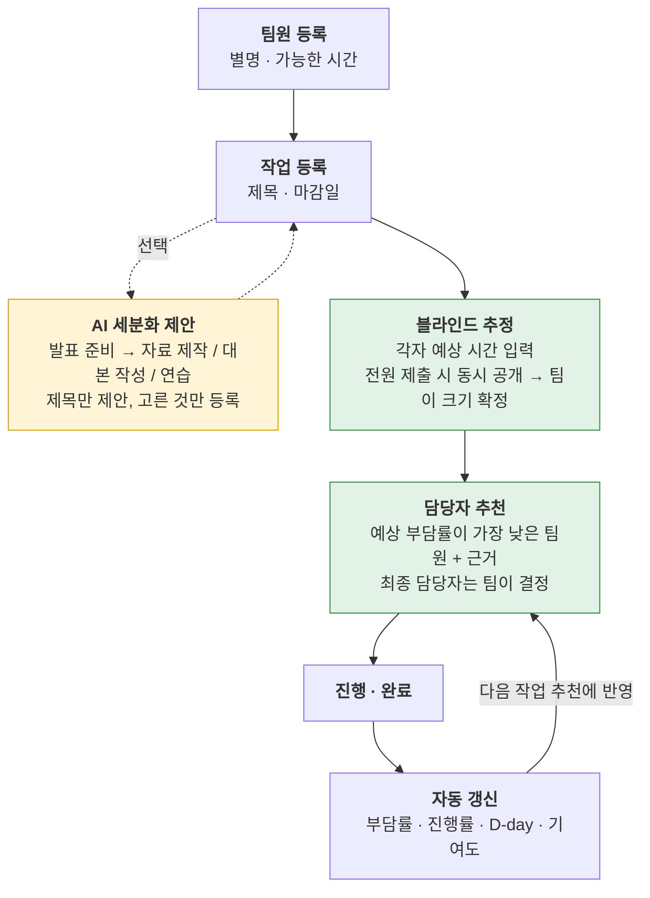
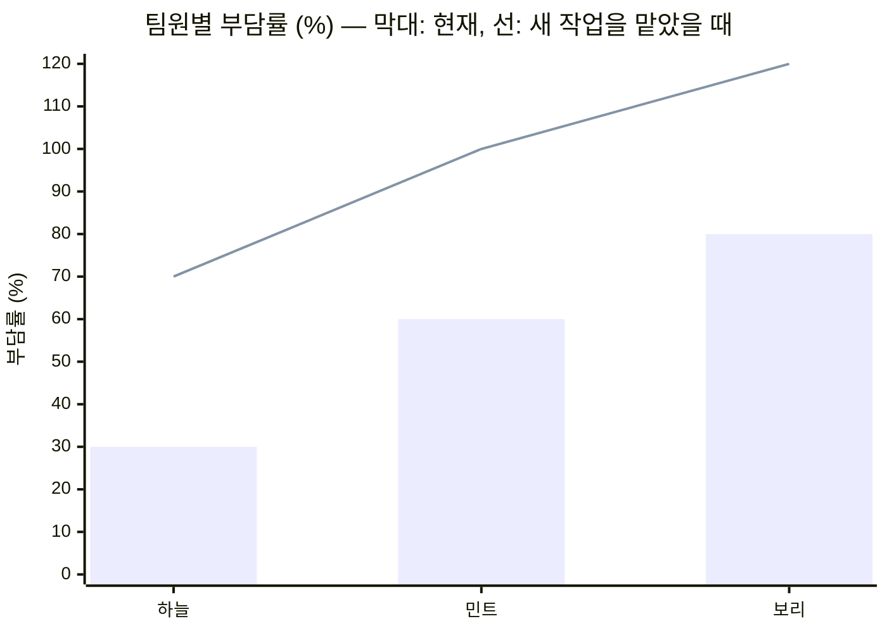
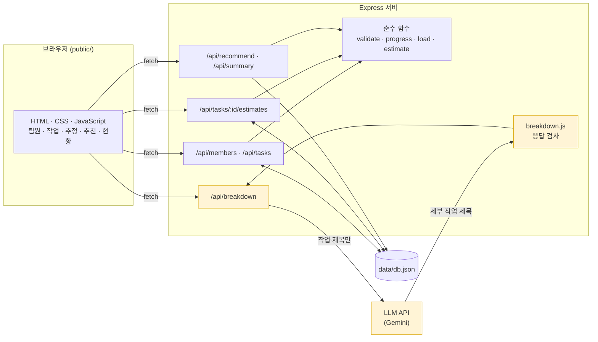

# 3oss — 팀 프로젝트 역할 분배 · 진행 관리

**팀원별 가능한 시간과 맡은 작업량으로 부담률을 계산하고, 새 작업을 누가 맡으면 가장 공정한지 추천하는 팀 프로젝트 협업 관리 서비스.**
작업의 크기는 한 사람이 정하지 않고, 팀원이 각자 추정한 뒤 한꺼번에 공개해 함께 맞춥니다.

2026 KW OSS 팀 프로젝트 · team03 · [제안 이슈 #4](https://github.com/kw-hdi-lab/oss2026-project/issues/4)

---

## 30초 요약

- **문제** — 팀 프로젝트에서는 팀원마다 쓸 수 있는 시간과 이미 맡은 일이 다릅니다. 새 작업이 생기거나 기존 작업이 밀리면 특정 팀원에게 일이 몰리고, 누가 얼마나 했는지를 두고 불만이 생깁니다.
- **해결** — 팀원의 가능한 시간과 작업을 한 화면에 저장해 두고, **작업 부담률을 자동 계산**합니다. 새 작업을 넣으면 **맡았을 때 예상 부담률이 가장 낮은 팀원을 추천**합니다. 작업이 추가 · 완료될 때마다 숫자가 다시 계산됩니다.
- **공정하게** — 작업량은 누군가 혼자 정하지 않습니다. **각자 따로 추정 → 전원 제출 후 동시 공개 → 팀이 확정**합니다. 추천은 참고 자료이고, **최종 담당자는 팀이 정합니다.**

## 풀려는 문제

**누가, 언제 불편한가.** 대학생이 팀 프로젝트를 할 때, 팀원마다 가능한 시간과 현재 작업량이 달라 역할을 공정하게 나누기 어렵습니다. 새 작업이 생기거나 기존 작업이 지연되면 특정 팀원에게 업무가 집중됩니다.

**지금은 어떻게 하나.** 카카오톡 · 노션 · 구글 스프레드시트로 역할을 나누고 진행 상황을 관리합니다. 팀원별 부담은 사람이 직접 비교해야 하고, 작업이 추가될 때마다 다시 조정해야 합니다.

**진짜 어려운 부분은 "작업량을 누가 어떻게 정하는가"입니다.** 같은 작업이라도 사람마다 크기를 다르게 느끼고, 팀 프로젝트의 불만은 대부분 여기서 나옵니다. 작업량이 한 사람의 감으로 정해지면 그 뒤의 부담률 계산은 단순한 나눗셈에 그칩니다. 그래서 이 서비스는 **작업량을 팀이 함께 정하는 과정**과 **실제로 누가 얼마나 했는지**를 계산의 앞뒤에 붙였습니다. (이슈 #4 검토 의견 반영)

## 어떻게 동작하나



노란색은 AI가 관여하는 유일한 단계, 초록색은 팀이 직접 결정하는 단계입니다.

### 예시 — 새 작업(4시간)을 누가 맡으면 좋을까



가능한 시간이 모두 10시간이라면 하늘 30% → 70%, 민트 60% → 100%, 보리 80% → 120% 이므로 **하늘을 추천**합니다. 보리가 맡으면 100%를 넘어 과부하로 표시됩니다.

## 주요 기능

| 기능 | 하는 일 |
|---|---|
| 팀원 관리 | 별명과 가능한 시간(시간 단위)을 등록 · 수정 |
| 작업 관리 | 작업 등록, 상태(할 일 · 진행 중 · 완료) 변경, 담당자 지정, 마감일 |
| AI 작업 세분화 | 큰 작업 제목을 넣으면 세부 작업 제목을 제안. 사용자가 고른 것만 등록 |
| 블라인드 추정 | 작업마다 팀원이 예상 시간을 따로 입력. 전원이 내기 전에는 서로의 값이 보이지 않음. 공개 후 차이가 크면 표시하고, 팀이 최종 크기를 확정 |
| 부담률 | 팀원별 현재 부담률을 막대로 표시. 100%를 넘으면 과부하 표시 |
| 담당자 추천 | 새 작업을 맡겼을 때의 예상 부담률을 팀원별로 비교해 추천하고, 근거 문장을 함께 표시 |
| 진행률 · D-day | 전체 진행률과 작업별 남은 날수 |
| 기여도 | 완료한 작업의 시간을 팀원별로 합산해 비율로 표시 |

## 계산 규칙

모든 숫자는 서버의 순수 함수가 계산합니다. 같은 입력이면 항상 같은 결과가 나오고, 화면 없이 `npm test` 로 "이 입력이면 이 결과"를 확인할 수 있습니다.

| 규칙 | 식 | 예외 처리 | 담당 |
|---|---|---|---|
| 작업 부담률 | (완료되지 않은 내 작업의 확정 시간 합 ÷ 가능한 시간) × 100 | 가능한 시간이 0이면 계산하지 않고 "배정 불가" | 박지호 |
| 담당자 추천 | 새 작업을 더했을 때 예상 부담률이 가장 낮은 팀원 | 가능한 시간이 0인 팀원은 제외. 동률이면 현재 부담률이 낮은 쪽, 그래도 같으면 먼저 등록된 팀원. 후보가 없으면 추천 없음 | 박지호 |
| 작업 진행률 | (완료한 작업 수 ÷ 전체 작업 수) × 100 | 전체 작업이 0개면 0% | 우희태 |
| D-day | 마감일 − 오늘 (날짜 단위) | 마감일이 없으면 표시하지 않음. 음수면 "지남" | 우희태 |
| 기여도 | (내가 완료한 작업의 확정 시간 합 ÷ 완료된 전체 시간 합) × 100 | 완료된 작업이 없으면 0% | 우희태 |
| 입력값 검사 | 별명 · 제목 길이, 시간 범위, 날짜 형식, 존재하는 id 인지 | 어긋나면 저장하지 않고 고칠 점을 안내 | 우희태 |
| 작업 크기 추정 | 전원 제출 시에만 공개. 중앙값을 기본값으로 제안 | 최댓값이 최솟값의 2배 이상이면 "의견 차이 큼". 확정 전 작업은 부담률에 넣지 않음 | 김권섭 |
| AI 응답 검사 | LLM 응답에서 제목 배열만 추출 | 형식이 어긋나면 빈 목록, 중복 · 빈 값 · 40자 초과 제거, 최대 7개 | 김권섭 |
| 추천 근거 문장 | 계산 결과로 고정 문구를 조립 | 후보 1명 · 후보 없음 · 전원 과부하 · 제외된 팀원 | 김권섭 |

## ChatGPT에 직접 묻는 것과 무엇이 다른가

| | ChatGPT에 직접 질문 | 카톡 · 노션 · 스프레드시트 | **3oss** |
|---|---|---|---|
| 상태 저장 | 작업이 바뀔 때마다 다시 입력 | 저장되지만 계산은 수동 | **저장하고 자동으로 다시 계산** |
| 여러 명이 함께 | 한 사람의 대화창 | 가능 | **같은 화면을 함께 관리** |
| 결과의 일관성 | 물을 때마다 달라질 수 있음 | 사람마다 다르게 판단 | **고정된 규칙이라 항상 같은 결과** |
| 작업량 결정 | 입력한 사람의 감 | 정한 사람의 감 | **각자 추정 후 동시 공개, 팀이 확정** |
| 실제 기여 | 알 수 없음 | 직접 세어야 함 | **완료 기록에서 자동 집계** |

## AI를 쓰는 곳과 쓰지 않는 곳

| | |
|---|---|
| **AI가 하는 일** | 서버가 작업 제목을 LLM에 보내고, 돌아온 세부 작업 **제목**을 검사해 화면에 제안으로 표시. 사용자가 고르면 작업으로 저장 |
| **AI가 하지 않는 일** | 시간 추정, 부담률 계산, 담당자 결정. 숫자는 AI를 거치지 않습니다 |
| **실패했을 때** | LLM 호출이 실패하거나 키가 없어도 작업 등록 · 추정 · 부담률 · 추천은 그대로 동작합니다. 세분화 칸만 직접 입력으로 바뀝니다 |
| **보내는 정보** | 작업 제목만 보냅니다. 팀원 별명과 시간 정보는 보내지 않습니다 |

추천 근거 문장도 서버가 계산한 값으로 만든 고정 문구입니다. AI가 쓴 문장에 틀린 숫자가 섞이는 일을 구조적으로 막기 위해서입니다.

## 기술

| | |
|---|---|
| 서버 | Node.js 20+ · Express |
| 프론트엔드 | HTML / CSS / JavaScript (프레임워크 없음) |
| 저장 | 서버의 JSON 파일 (`data/db.json`) |
| AI | 서버에서 LLM API 호출 (Google Gemini 무료 등급) |
| 테스트 | Node 내장 테스트 러너 (`node --test`) |



LLM은 `/api/breakdown` 한 경로에만 연결되어 있고, 계산과 저장에는 닿지 않습니다. 화면 갱신은 `fetch` 로만 하며 WebSocket 같은 실시간 통신은 쓰지 않습니다.

## API

| 메서드 · 경로 | 하는 일 | 담당 |
|---|---|---|
| `GET /api/members` | 팀원 목록 | 우희태 |
| `POST /api/members` · `PATCH /api/members/:id` | 팀원 등록 · 수정 | 우희태 |
| `GET /api/tasks` | 작업 목록 (추정값은 공개 전까지 숨김) | 우희태 |
| `POST /api/tasks` · `PATCH /api/tasks/:id` | 작업 등록, 상태 · 담당자 · 확정 시간 · 마감일 수정 | 우희태 |
| `POST /api/recommend` | 예상 부담률 비교와 추천 담당자, 근거 문장 | 박지호 |
| `GET /api/summary` | 팀원별 부담률 · 기여도, 전체 진행률 | 박지호 |
| `POST /api/tasks/:id/estimates` | 내 추정 시간 제출 | 김권섭 |
| `POST /api/breakdown` | 세부 작업 제목 제안 (LLM) | 김권섭 |

요청 · 응답 형식은 [팀 브리프](team/README.md)에 있습니다.

## 과제 조건 대응

[과목 저장소](https://github.com/kw-hdi-lab/oss2026-project) README 2장 "주제가 갖춰야 할 조건"에 하나씩 대응합니다.

| 조건 | 이 프로젝트에서 |
|---|---|
| **화면** — 값을 입력 · 선택하고 결과를 확인 | 가능한 시간 · 작업 · 추정 시간을 입력하고, 담당자를 선택하면 부담률 막대 · 추천 · 진행률이 바뀝니다 |
| **계산 규칙** — 테스트 5개 이상 | 위 [계산 규칙](#계산-규칙) 9개. 전부 순수 함수라 화면 없이 `npm test` 로 확인합니다 |
| **서버** — 저장 또는 외부 API, 엔드포인트 2개 이상 | JSON 파일 저장 + LLM API 호출. 엔드포인트 8개 |
| **LLM 호출** — 서버가 앱 데이터를 보내고 응답을 기능에 사용 | 작업 제목을 보내 세부 작업 제목을 받고, 검사한 뒤 화면에 제안으로 표시 · 선택한 것을 저장. 실패해도 나머지 기능은 동작 |
| **규모** — 메모리 512MB, 무료 플랜 | 의존성은 Express 하나. DB 서버 · GPU · 대용량 파일 없음 |
| **공개** — 공개해도 되는 데이터만 | 별명 · 가능한 시간 · 작업 제목만 저장. `.env` 와 `data/` 는 커밋하지 않습니다 |
| **세 사람의 몫** — 각자 화면 · 계산 규칙 · 서버 API를 하나 이상 | 아래 [팀](#팀--team03) 표. 최종 발표에서 각자 자기 부분을 시연합니다 |

### 제한 사항 (4장)

| 제한 | 이 프로젝트에서 |
|---|---|
| 회원가입 · 로그인 · 결제 금지 | 만들지 않습니다. "누구로 입력하나요"를 화면에서 고르는 방식입니다 |
| 실제 개인정보 수집 금지 | 실명 · 학번 · 연락처를 받지 않습니다. 팀원은 **별명**으로 등록하고, 입력 칸에 그렇게 안내합니다 |
| 크롤링 금지 | 외부 사이트에서 가져오는 데이터가 없습니다 |
| 유료 API 필수 금지 | LLM은 무료 등급으로 호출하고, 키가 없어도 앱이 동작합니다 |
| 실시간 통신은 부가 기능으로만 | 쓰지 않습니다. 모든 기능이 Express API 만으로 동작합니다 |

> 로그인이 없으므로 배포된 앱은 주소를 아는 누구나 보고 고칠 수 있습니다. 공개돼도 되는 내용만 입력합니다.

## 직접 실행하기

```bash
npm install
```

```bash
cp .env.example .env
```

```bash
npm start
```

`http://localhost:3000` 접속.

| 환경 변수 | 설명 |
|---|---|
| `PORT` | 기본 `3000` |
| `GEMINI_API_KEY` | LLM API 키. **비워도 앱은 동작** — 세분화 제안만 꺼집니다 |
| `GEMINI_MODEL` | 사용할 모델 이름 |

```bash
npm test
```

## 프로젝트 구조

```
server.js              서버 시작
src/
  app.js               Express 앱 · 라우트 연결
  routes/              members · tasks · recommend · summary · estimates · breakdown
  lib/
    store.js           data/db.json 읽기 · 쓰기
    load.js            부담률 · 담당자 추천
    validate.js        입력값 검사
    progress.js        진행률 · D-day · 기여도
    estimate.js        블라인드 추정 요약
    breakdown.js       LLM 응답 검사
    explain.js         추천 근거 문장
    llm.js             LLM API 호출
public/
  index.html · style.css
  js/                  api.js · board.js · load.js · sizing.js
test/                  단위 테스트
team/                  역할 분담 · 개인별 지침서
```

## 개발 관리

- **PR 기반** — `main` ← `이름/작업` 브랜치. 팀원 1명 승인 후 Squash merge
- **커밋은 기능 하나 · 담당 영역 하나 단위** — 한 커밋에 남의 영역을 섞지 않습니다
- **커밋 메시지** — `<타입>: <제목>`. 변경의 성격에 따라 타입을 나눕니다

| 타입 | 의미 | 예 |
|---|---|---|
| `Feat` | 새 기능 | `Feat: 예상 부담률이 가장 낮은 팀원 추천` |
| `Fix` | 버그 수정 | `Fix: 가능한 시간이 0인 팀원이 추천에 섞이는 문제` |
| `Test` | 테스트 추가 · 수정 | `Test: 추정값 중앙값 · 의견 차이 판정 케이스` |
| `Style` | 로직에 영향 없는 화면 · 포맷 변경 | `Style: 과부하 막대에 글자 표시 추가` |
| `Refactor` | 기능 변경 없는 구조 개선 | `Refactor: 작업 검증을 validate.js 로 분리` |
| `Docs` | 문서 | `Docs: 과제 조건 대응 표 추가` |
| `Chore` | 설정 · 패키지 | `Chore: Express 스캐폴드와 실행 스크립트 추가` |

자세한 규칙은 [CONTRIBUTING.md](CONTRIBUTING.md)에 있습니다.

## 제안 검토에서 받은 지적과 대응

| 지적 | 대응 |
|---|---|
| 역할 추천만으로는 ChatGPT에 묻는 것과 다르지 않다 | 작업 정보를 저장 · 공유하고, 작업이 추가 · 완료될 때마다 부담률을 자동 갱신 |
| 작업 시간만으로 공정성을 판단하기 어렵다 | 계산 결과는 참고 자료로만 쓰고 최종 담당자는 팀이 결정. 난이도 · 선호 역할 반영은 이후 확장 |
| 작업량을 누가 어떻게 정하는지가 가장 어렵다 | 블라인드 추정 — 각자 추정 후 동시 공개, 팀이 확정 |
| 처음 분배보다 실제 기여를 두고 불편함이 크다 | 완료 기록으로 기여도를 자동 집계 |

## 팀 — team03

세 명이 각자 **화면 · 계산 규칙 · 서버 API**를 하나 이상씩 맡고, 최종 발표에서 자기 부분을 직접 시연합니다.

| 담당 | 화면 | 계산 규칙 | 서버 API | 지침서 |
|---|---|---|---|---|
| **김권섭** [@kwonseop](https://github.com/kwonseop)<br/>작업 정하기 — AI 세분화 · 추정 · 추천 설명 | AI 세분화 제안, 블라인드 추정 | AI 응답 검사, 추정 요약(중앙값 · 의견 차이), 추천 근거 문장 | `POST /api/breakdown`<br/>`POST /api/tasks/:id/estimates` | [A](team/A-kwonseop.md) |
| **박지호** [@parkjiho-1104](https://github.com/parkjiho-1104)<br/>나누기 — 저장 · 부담률 · 담당자 추천 | 부담률 막대, 담당자 추천 · 배정 | 작업 부담률, 담당자 추천 | `POST /api/recommend`<br/>`GET /api/summary` | [B](team/B-jiho.md) |
| **우희태** [@Heetaeeee](https://github.com/Heetaeeee)<br/>관리하기 — 팀원 · 작업 · 진행률 | 팀원 등록, 작업 관리, 진행률 · 기여도 | 입력값 검사, 진행률, D-day, 기여도 | `/api/members`<br/>`/api/tasks` | [C](team/C-heetae.md) |

## 오픈소스 · 출처

| 이름 | 용도 | 라이선스 |
|---|---|---|
| [Express](https://github.com/expressjs/express) | 웹 서버 | MIT |

| 외부 서비스 | 용도 |
|---|---|
| [Google Gemini API](https://ai.google.dev/) | 세부 작업 제목 제안 — 숫자 계산과 담당자 결정에는 쓰지 않음 |
