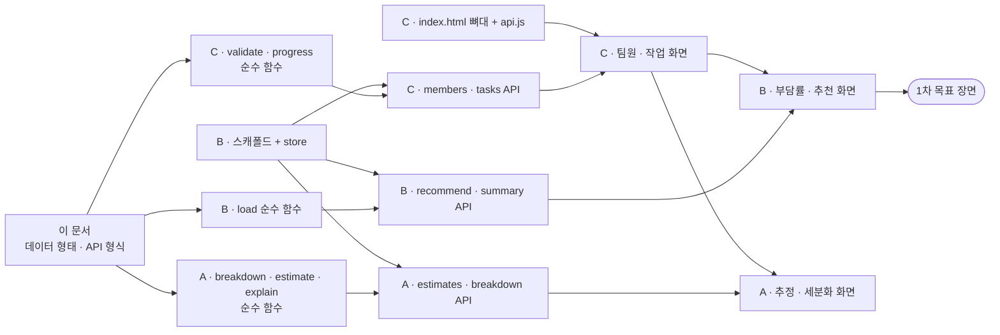

# 역할 분담과 착수 순서

제품이 무엇이고 왜 이렇게 설계했는지는 루트의 [README.md](../README.md)를, 브랜치 · 커밋 규칙은 [CONTRIBUTING.md](../CONTRIBUTING.md)를 먼저 읽어주세요.
이 문서는 세 명이 **서로 기다리지 않고** 동시에 작업하기 위한 공용 계약입니다.

## 담당 — 각자 화면 · 계산 규칙 · 서버`{ memberId, hours, reason? }` | `Task` | API를 하나 이상

과제 조건상 **팀원마다 화면, 계산 규칙, 서버 API를 하나 이상씩 맡고 최종 발표에서 자기 부분을 직접 시연**해야 합니다. 그래서 "프론트 / 백엔드 / AI"로 나누지 않고, **기능 단위로 화면부터 서버까지 세로로** 나눕니다.

| | **A 김권섭** — 작업 정하기 | **B 박지호** — 나누기 | **C 우희태** — 관리하기 |
|---|---|---|---|
| 화면 | AI 세분화 제안, 블라인드 추정 | 부담률 막대, 담당자 추천 · 배정 | 팀원 등록, 작업 보드, 진행률 · 완료 작업 비중 |
| 계산 규칙 | AI 응답 검사, 추정 요약, 추천 근거 문장 | 작업 부담률, 담당자 추천 | 입력값 검사, 진행률, D-day, 완료 작업 비중 |
| 서버 API | `POST /api/breakdown`<br/>`POST /api/tasks/:id/estimates` | `POST /api/recommend`<br/>`GET /api/summary` | `/api/members`<br/>`/api/tasks` |
| 공용 뼈대 | LLM 호출 | Express 스캐폴드, 저장(`store`) | `index.html` · `style.css` · `api.js` |
| 지침서 | [A-kwonseop.md](A-kwonseop.md) | [B-jiho.md](B-jiho.md) | [C-heetae.md](C-heetae.md) |

이슈 #4의 담당(AI 세분화 · 설명 · 추천 / 저장 · 부담률 · 추천 / 팀원 등록 · 작업 화면 · 시각화)을 그대로 두고, 각자에게 빠져 있던 조각(화면 · 규칙 · API)을 채운 것입니다.

## 가장 먼저 완성할 장면

**팀원 3명의 가능한 시간과 작업을 넣고 새 작업을 추가하면, 추천 담당자와 예상 부담률이 뜨는 것.**
작업 하나를 완료 처리하면 부담률 막대와 추천 결과가 바뀌는 것까지가 1차 목표입니다.

그 뒤에 블라인드 추정 → 완료 작업 비중 → AI 세분화 순으로 붙입니다. AI가 없어도 서비스가 성립해야 하기 때문입니다.

1차 목표에서는 작업 크기(`hours`)를 작업 카드에서 **직접 입력**합니다. 블라인드 추정이 붙으면 "추정해서 정하기"가 그 옆에 추가됩니다.

## 의존 관계 — 여기가 막히면 전원이 멈춥니다



**0순위는 둘입니다 — B의 스캐폴드와 C의 화면 뼈대.** 둘 다 반나절 안에 올려주세요. 순수 함수는 아무것도 기다리지 않으니 세 명 모두 첫날 바로 시작합니다.

**이 문서의 데이터 형태와 API 형식을 바꿀 때는 반드시 먼저 공유합니다.**

## 공용 데이터 형태

```js
// 팀원
{
  id: 'm1',
  name: '김권섭',             // 팀원 이름. 학번 · 연락처는 받지 않는다
  availableHours: 10        // 이번 주 가능한 시간(시간). 0 이상의 숫자
}

// 작업
{
  id: 't1',
  title: '발표 자료 제작',
  parentId: null,           // 세분화로 만든 작업이면 상위 작업 id
  status: 'TODO',           // 'TODO' | 'DOING' | 'DONE'
  assigneeId: null,         // 팀원 id 또는 null
  dueDate: '2026-12-01',    // 'YYYY-MM-DD' 또는 null
  hours: null,              // 팀이 확정한 작업 크기(시간). 확정 전에는 null
  estimates: { m1: { hours: 3, reason: "슬라이드 10장 기준" } },  // 팀원 id → 추정 시간과 근거. 서버 안에서만 보관
  createdAt: '2026-11-10T09:00:00.000Z'
}
```

**`estimates` 는 서버 밖으로 그대로 나가지 않습니다.** `GET /api/tasks` 응답에서는 `estimate` 요약으로 바뀝니다.

```js
// 전원이 내기 전
estimate: { revealed: false, submittedIds: ['m1'] }

// 전원이 낸 뒤
estimate: { revealed: true, submittedIds: ['m1','m2','m3'],
            values: { m1: 3, m2: 4, m3: 8 }, median: 4, wideSpread: true,
            reasons: { m1: "슬라이드 10장 기준", m3: "디자인까지 포함" } }
```

## API 형식

오류는 전부 `{ "error": "무엇을 고치면 되는지 알려주는 한국어 문장" }` 과 4xx 상태 코드로 돌려줍니다. 화면은 그 문장을 그대로 띄웁니다.

| 메서드 · 경로 | 요청 본문 | 응답 | 담당 |
|---|---|---|---|
| `GET /api/members` | — | `Member[]` | C |
| `POST /api/members` | `{ name, availableHours }` | `Member` (201) | C |
| `PATCH /api/members/:id` | `{ name?, availableHours? }` | `Member` | C |
| `GET /api/tasks` | — | `Task[]` (`estimates` 대신 `estimate`) | C |
| `POST /api/tasks` | `{ title, dueDate?, parentId? }` | `Task` (201) | C |
| `PATCH /api/tasks/:id` | `{ status?, assigneeId?, hours?, dueDate?, title? }` | `Task` | C |
| `POST /api/recommend` | `{ taskId }` 또는 `{ hours }` | 아래 | B |
| `GET /api/summary` | — | 아래 | B |
| `POST /api/tasks/:id/estimates` | `{ memberId, hours }` | `Task` | A |
| `POST /api/breakdown` | `{ title }` | `{ subtasks: string[], source: 'ai' \| 'fallback' }` | A |

```js
// POST /api/recommend 응답
{
  recommendedId: 'm2',               // 후보가 없으면 null
  candidates: [                      // 예상 부담률 오름차순
    { memberId: 'm2', name: '박지호', currentLoad: 30, projectedLoad: 50 },
    { memberId: 'm1', name: '김권섭', currentLoad: 60, projectedLoad: 100 }
  ],
  excluded: [ { memberId: 'm3', name: '우희태', reason: 'NO_AVAILABLE_TIME' } ],
  explanation: '박지호 님이 맡으면 부담률이 30% → 50%로 가장 낮습니다.'
}

// GET /api/summary 응답
{
  progress: 40,                      // 전체 진행률 %
  doneHoursTotal: 12,                // 완료된 작업의 확정 예상 시간 합
  members: [
    { memberId: 'm1', name: '김권섭', load: 60, overloaded: false, doneShare: 50, doneHours: 6 }
    // 가능한 시간이 0이면 load: null
  ]
}
```

부담률 · 진행률 · 완료 작업 비중는 **반올림한 정수**로 내려보냅니다.

## 서로의 함수를 부르는 곳

세로로 나누면 경계에서 남의 순수 함수를 불러야 합니다. 아래 세 곳뿐입니다. **상대 함수가 아직 없으면 임시 값으로 먼저 머지하고, 생기면 한 줄을 바꿉니다.**

| 부르는 쪽 | 불리는 함수 | 없을 때 임시 값 |
|---|---|---|
| C `GET /api/tasks` | A `estimateSummary(estimates, memberIds)` | `{ revealed: false, submittedIds: [] }` |
| B `POST /api/recommend` | A `explainRecommendation(result)` | `''` |
| B `GET /api/summary` | C `progressPercent(tasks)` · `doneShare(memberId, tasks)` | `0` · `{ percent: 0, hours: 0, totalHours: 0 }` |

## 화면을 나눠 쓰는 법

페이지는 `public/index.html` 하나입니다. C가 뼈대를 만들고, 각자 **자기 JS 파일이 자기 자리만** 채웁니다.

| 자리 | 채우는 사람 · 파일 |
|---|---|
| `#members` · `#tasks` · `#progress` | C · `public/js/board.js` |
| `#load` (부담률 막대), 작업 카드의 `[data-slot="recommend"]` | B · `public/js/load.js` |
| `#breakdown`, 작업 카드의 `[data-slot="sizing"]` | A · `public/js/sizing.js` |

`public/js/api.js` (C 작성)가 두 가지를 내보냅니다.

```js
export async function api(path, options)   // fetch + JSON + 오류 문장 throw
export async function refresh()            // members · tasks · summary 를 받아 'data' 이벤트 발행
```

```js
// 각자 파일에서
import { api, refresh } from './api.js';
document.addEventListener('data', (e) => {
  const { members, tasks, summary } = e.detail;
  // 자기 자리만 다시 그린다
});
```

**데이터를 바꾼 뒤에는 항상 `refresh()` 를 부릅니다.** 그러면 세 명의 화면이 함께 갱신됩니다. 실시간 통신은 쓰지 않습니다.

## 전원이 지키는 원칙 넷

**1. 숫자는 AI를 거치지 않습니다.**
부담률 · 추천 · 진행률 · 완료 작업 비중는 순수 함수만 계산합니다. LLM은 세부 작업 **제목**만 제안합니다.

**2. AI가 죽어도 나머지는 동작합니다.**
`/api/breakdown` 은 실패해도 500을 내지 않고 `{ subtasks: [], source: 'fallback' }` 을 돌려줍니다.

**3. 추천은 참고 자료이고, 결정은 사람이 합니다.**
서버는 담당자를 자동으로 지정하지 않습니다. 작업 크기도 중앙값을 제안할 뿐 팀이 확정합니다.

**4. 개인정보를 받지 않습니다.**
로그인 · 회원가입이 없고, 팀원은 이름과 가능한 시간만 등록합니다. 저장소와 배포된 앱이 공개되므로 학번 · 연락처 같은 정보는 받지도, 예시 데이터에 쓰지도 않습니다.

## 착수 순서

| 단계 | A 김권섭 | B 박지호 | C 우희태 |
|---|---|---|---|
| **0** 뼈대 | — | **스캐폴드 + `store.js`** | **`index.html` 뼈대 + `api.js`** |
| **1** 순수 함수 + 테스트 | `breakdown` · `estimate` · `explain` | `load` (부담률 · 추천) | `validate` · `progress` |
| **2** API | — | `recommend` · `summary` | `members` · `tasks` |
| **3** 화면 → **1차 목표** | (B의 추천 화면에 설명 문장 확인) | 부담률 막대, 추천 · 배정 | 팀원 등록, 작업 보드, 진행률 |
| **4** 추정 | `estimates` API + 추정 화면 | — | 완료 작업 비중 표시 |
| **5** AI | `llm` + `breakdown` API + 세분화 화면 | — | — |
| **6** 통합 | 전원 — 처음부터 끝까지 눌러보기, 배포, 발표 준비 | | |

**단계 3이 끝나면 한 번 모여서 처음부터 끝까지 눌러봅니다.**

A는 단계 2~3에서 손이 빕니다. 그때 단계 4 · 5의 순수 함수와 API를 미리 만들어 두고, B · C의 PR을 리뷰합니다.

## 파일 소유

| 담당 | 파일 |
|---|---|
| A | `src/lib/breakdown.js` · `estimate.js` · `explain.js` · `llm.js`<br/>`src/routes/breakdown.js` · `estimates.js`<br/>`public/js/sizing.js`<br/>`test/breakdown.test.js` · `estimate.test.js` · `explain.test.js` |
| B | `package.json` · `server.js` · `src/app.js` · `.env.example`<br/>`src/lib/store.js` · `load.js`<br/>`src/routes/recommend.js` · `summary.js`<br/>`public/js/load.js`<br/>`test/load.test.js` |
| C | `src/lib/validate.js` · `progress.js`<br/>`src/routes/members.js` · `tasks.js`<br/>`public/index.html` · `style.css` · `public/js/api.js` · `board.js`<br/>`test/validate.test.js` · `progress.test.js` |

남의 파일을 고쳐야 하면 고치기 전에 담당자에게 말하고, **커밋을 따로 냅니다.**

## 테스트

**계산과 검사가 걸린 순수 함수만** Node 내장 테스트 러너로 씁니다. 화면과 라우트 연결은 `npm start` 후 브라우저로 확인합니다.

과제 조건은 테스트 5개 이상입니다. 각 지침서에 담당별로 그보다 많은 케이스가 그대로 적혀 있습니다. **테스트를 먼저 쓰고 실패를 확인한 뒤 구현하세요.**

## 최종 발표 — 각자 시연할 장면

| 담당 | 시연 |
|---|---|
| C 우희태 | 팀원 3명과 작업을 등록 → 잘못된 값을 넣어 안내 문장 확인 → 작업을 완료로 바꿔 진행률 · 완료 작업 비중 변화 |
| A 김권섭 | "발표 준비"를 AI로 나눠 등록 → 세 명이 추정값 제출 → 동시 공개 · 의견 차이 → 크기 확정. API 키를 비워도 동작하는 것 |
| B 박지호 | 새 작업에 담당자 추천 → 근거 문장과 예상 부담률 → 배정 → 막대 변화. 가능한 시간 0인 팀원이 제외되는 것 |
