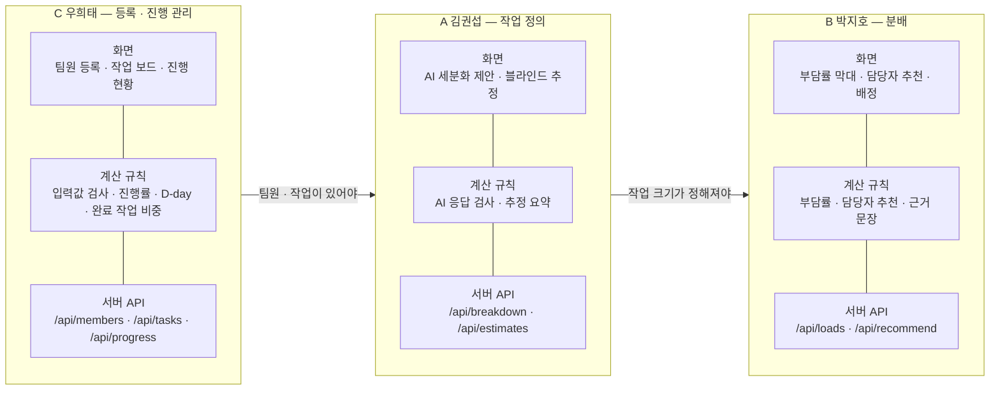
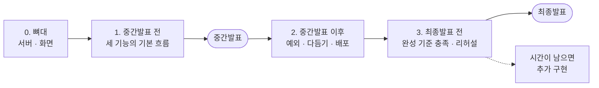

# 역할 분담과 일정

제품이 무엇이고 왜 이렇게 설계했는지는 루트의 [README.md](../README.md)를, 브랜치 · 커밋 규칙은 [CONTRIBUTING.md](../CONTRIBUTING.md)를 먼저 읽어주세요.
이 문서는 세 명이 **서로 기다리지 않고** 동시에 작업하기 위한 공용 계약입니다.

## 나누는 원칙 — 기능을 셋으로, 각자 화면부터 서버까지

한 사람이 화면만, 다른 사람이 서버 API만 맡는 식으로 나누지 않습니다.
**앱의 기능을 셋으로 나누고, 각자 자기 기능에 필요한 화면 · 계산 규칙 · 서버 API를 모두 만듭니다.** 최종 발표에서도 각자 자기 기능을 직접 시연합니다.



사용자가 앱을 쓰는 순서가 곧 기능의 순서입니다 — **등록하고(C) → 무엇을 얼마나 할지 정하고(A) → 누가 할지 나눈다(B)** → 진행 상황을 본다(C).

## 기능 명세

### C 우희태 — 등록 · 진행 관리 기능

> 팀원과 작업을 등록하고, 진행 상황을 숫자로 보여준다.

| | 만드는 것 | 파일 |
|---|---|---|
| **화면** | 팀원 등록 폼 · 목록, 작업 등록 폼 · 작업 보드(상태 · 담당자 · 크기 · 마감일), 진행 현황(진행률 · D-day · 완료 작업 비중) | `public/js/board.js` |
| **계산 규칙** | 입력값 검사, 진행률, D-day, 완료 작업 비중 | `src/lib/validate.js` · `progress.js` |
| **서버 API** | `GET · POST · PATCH /api/members`<br/>`GET · POST · PATCH /api/tasks`<br/>`GET /api/progress` | `src/routes/members.js` · `tasks.js` · `progress.js` |
| **테스트** | 21개 | `test/validate.test.js` · `progress.test.js` |
| **시연** | 팀원 · 작업 등록 → 잘못된 값에 안내 문장 → 완료 처리 → 진행률 · 완료 작업 비중 변화 | |

### A 김권섭 — 작업 정의 기능

> 큰 작업을 AI로 나누고, 각 작업의 크기를 팀이 함께 정한다.

| | 만드는 것 | 파일 |
|---|---|---|
| **화면** | AI 세분화 제안(체크박스로 골라 등록), 블라인드 추정(시간 · 근거 제출 → 동시 공개 → 크기 확정) | `public/js/sizing.js` |
| **계산 규칙** | AI 응답 검사, 추정 요약(공개 조건 · 중앙값 · 의견 차이 · 근거) | `src/lib/breakdown.js` · `estimate.js` |
| **서버 API** | `POST /api/breakdown` (LLM 호출)<br/>`POST /api/tasks/:id/estimates`<br/>`GET /api/estimates` | `src/routes/breakdown.js` · `estimates.js`, `src/lib/llm.js` |
| **테스트** | 18개 | `test/breakdown.test.js` · `estimate.test.js` |
| **시연** | "발표 준비"를 AI로 나눠 등록 → 세 명이 추정 제출 → 동시 공개 · 의견 차이 → 크기 확정. API 키를 비워도 동작하는 것 | |

### B 박지호 — 분배 기능

> 팀원별 부담률을 계산하고, 새 작업을 누가 맡으면 좋을지 근거와 함께 추천한다.

| | 만드는 것 | 파일 |
|---|---|---|
| **화면** | 부담률 막대(과부하 표시), 담당자 추천 패널(근거 문장 · 예상 부담률 · 배정 버튼) | `public/js/load.js` |
| **계산 규칙** | 작업 부담률, 담당자 추천(제외 · 동률 규칙), 추천 근거 문장 | `src/lib/load.js` · `explain.js` |
| **서버 API** | `GET /api/loads`<br/>`POST /api/recommend` | `src/routes/loads.js` · `recommend.js` |
| **테스트** | 15개 | `test/load.test.js` · `explain.test.js` |
| **시연** | 새 작업에 담당자 추천 → 근거 문장과 예상 부담률 → 배정 → 막대 변화. 가능한 시간 0인 팀원이 제외되는 것 | |

### 공용 뼈대 — 기능이 아니라 바닥

어느 기능에도 속하지 않지만 누군가는 먼저 깔아야 하는 것입니다. 각자의 "기능"으로 세지 않습니다.

| 뼈대 | 담당 | 내용 |
|---|---|---|
| 서버 뼈대 | B | `package.json` · `server.js` · `src/app.js` (빈 라우터 7개 연결) · `src/lib/store.js` (JSON 파일 저장) |
| 화면 뼈대 | C | `public/index.html` (구역과 자리) · `style.css` · `public/js/api.js` |

이슈 #4의 "역할 분배 설명"은 추천 결과를 설명하는 문장이라 **분배 기능(B)** 에 넣었습니다. 추천과 그 근거가 한 사람의 기능 안에 있어야 "각자 자기 기능의 화면 · 규칙 · API"가 성립합니다.

## 기능 사이의 경계

**남의 함수를 부르지 않습니다.** 기능끼리는 저장된 데이터와 화면의 `'data'` 이벤트로만 만납니다.

| 만나는 곳 | 규칙 |
|---|---|
| 저장 | 세 기능 모두 B의 `store.load()` / `store.save()` 로 같은 `data/db.json` 을 읽고 씁니다 |
| 작업 크기 `hours` | A의 추정 화면이 확정 → C의 `PATCH /api/tasks/:id { hours }` 호출 |
| 담당자 `assigneeId` | B의 추천 화면이 배정 → C의 `PATCH /api/tasks/:id { assigneeId }` 호출 |
| 세부 작업 등록 | A의 세분화 화면이 고른 제목 → C의 `POST /api/tasks { title, parentId }` 호출 |
| 추정값 | C의 작업 응답에는 `estimates` 가 **없습니다.** A의 `GET /api/estimates` 만 요약을 내보냅니다 |
| 화면 갱신 | 누구든 데이터를 바꾸면 `refresh()` → `'data'` 이벤트 → 각자 자기 API를 불러 자기 자리를 다시 그립니다 |

## 공용 데이터 형태

```js
// 팀원
{
  id: 'm1',
  name: '김권섭',           // 팀원 이름. 학번 · 연락처는 받지 않는다
  availableHours: 10        // 이번 주 가능한 시간(시간). 0 이상의 숫자
}

// 작업
{
  id: 't1',
  title: '발표 자료 제작',
  parentId: null,           // 세분화로 만든 작업이면 상위 작업 id
  status: 'TODO',           // 'TODO' | 'DOING' | 'DONE'
  assigneeId: null,         // 팀원 id 또는 null
  dueDate: '2026-12-01',    // 'YYYY-MM-DD' 또는 null
  hours: null,              // 팀이 확정한 작업 크기(시간). 확정 전에는 null
  estimates: { m1: { hours: 3, reason: '슬라이드 10장 기준' } },  // 서버 안에서만 보관. A만 읽고 쓴다
  createdAt: '2026-11-10T09:00:00.000Z'
}
```

**이 형태와 아래 API 형식을 바꿀 때는 반드시 먼저 공유합니다.**

## API 형식

오류는 전부 `{ "error": "무엇을 고치면 되는지 알려주는 한국어 문장" }` 과 4xx 상태 코드로 돌려줍니다. 화면은 그 문장을 그대로 띄웁니다.

| 기능 | 메서드 · 경로 | 요청 본문 | 응답 |
|---|---|---|---|
| C | `GET /api/members` | — | `Member[]` |
| C | `POST /api/members` | `{ name, availableHours }` | `Member` (201) |
| C | `PATCH /api/members/:id` | `{ name?, availableHours? }` | `Member` |
| C | `GET /api/tasks` | — | `Task[]` (`estimates` 필드 없이) |
| C | `POST /api/tasks` | `{ title, dueDate?, parentId? }` | `Task` (201) |
| C | `PATCH /api/tasks/:id` | `{ status?, assigneeId?, hours?, dueDate?, title? }` | `Task` |
| C | `GET /api/progress` | — | 아래 |
| A | `POST /api/breakdown` | `{ title }` | `{ subtasks: string[], source: 'ai' \| 'fallback' }` |
| A | `POST /api/tasks/:id/estimates` | `{ memberId, hours, reason? }` | `{ taskId, estimate }` |
| A | `GET /api/estimates` | — | `{ [taskId]: estimate }` |
| B | `GET /api/loads` | — | 아래 |
| B | `POST /api/recommend` | `{ taskId }` 또는 `{ hours }` | 아래 |

```js
// C — GET /api/progress
{
  progress: 40,                      // 전체 진행률 %
  doneHoursTotal: 12,                // 완료된 작업의 확정 예상 시간 합
  members: [ { memberId: 'm1', name: '김권섭', doneShare: 50, doneHours: 6 } ]
}

// A — estimate 요약
{ revealed: false, submittedIds: ['m1'] }                       // 전원이 내기 전
{ revealed: true, submittedIds: ['m1','m2','m3'],               // 전원이 낸 뒤
  values: { m1: 3, m2: 4, m3: 8 }, median: 4, wideSpread: true,
  reasons: { m1: '슬라이드 10장 기준', m3: '디자인까지 포함' } }

// B — GET /api/loads
{ members: [ { memberId: 'm1', name: '김권섭', load: 60, overloaded: false } ] }   // 가능한 시간이 0이면 load: null

// B — POST /api/recommend
{
  recommendedId: 'm2',               // 후보가 없으면 null
  candidates: [                      // 예상 부담률 오름차순
    { memberId: 'm2', name: '박지호', currentLoad: 30, projectedLoad: 50 },
    { memberId: 'm1', name: '김권섭', currentLoad: 60, projectedLoad: 100 }
  ],
  excluded: [ { memberId: 'm3', name: '우희태', reason: 'NO_AVAILABLE_TIME' } ],
  explanation: '박지호 님이 맡으면 부담률이 30% → 50%로 가장 낮습니다.'
}
```

부담률 · 진행률 · 완료 작업 비중은 **반올림한 정수**로 내려보냅니다.

## 화면을 나눠 쓰는 법

페이지는 `public/index.html` 하나입니다. C가 뼈대를 깔고, 각자 **자기 JS 파일이 자기 자리만** 채웁니다.
색 · 글자 · 부품 · 상태별 모양은 [화면 디자인 가이드](DESIGN.md)와 [목업](design-mockup.html)을 따릅니다.

| 자리 | 채우는 기능 · 파일 |
|---|---|
| `#members` · `#tasks` · `#progress` | C · `public/js/board.js` |
| `#breakdown`, 작업 카드의 `[data-slot="sizing"]` | A · `public/js/sizing.js` |
| `#load`, 작업 카드의 `[data-slot="recommend"]` | B · `public/js/load.js` |

```js
// public/js/api.js (C 작성)
export async function api(path, options)   // fetch + JSON + 오류 문장 throw
export async function refresh()            // members · tasks 를 받아 'data' 이벤트 발행

// 각자 파일에서
import { api, refresh } from './api.js';
document.addEventListener('data', async (e) => {
  const { members, tasks } = e.detail;
  // 필요하면 자기 API(/api/progress · /api/estimates · /api/loads)를 부르고 자기 자리만 다시 그린다
});
```

**데이터를 바꾼 뒤에는 항상 `refresh()` 를 부릅니다.** 실시간 통신은 쓰지 않습니다.

## 전원이 지키는 원칙 넷

**1. 숫자는 AI를 거치지 않습니다.** 부담률 · 추천 · 진행률 · 완료 작업 비중은 순수 함수만 계산합니다. LLM은 세부 작업 **제목**만 제안합니다.

**2. AI가 죽어도 나머지는 동작합니다.** `/api/breakdown` 은 실패해도 500을 내지 않고 `{ subtasks: [], source: 'fallback' }` 을 돌려줍니다.

**3. 추천은 참고 자료이고, 결정은 사람이 합니다.** 서버는 담당자를 자동으로 지정하지 않습니다. 작업 크기도 중앙값을 제안할 뿐 팀이 확정합니다.

**4. 개인정보를 받지 않습니다.** 로그인 · 회원가입이 없고, 팀원은 이름과 가능한 시간만 등록합니다. 학번 · 연락처 같은 정보는 받지도, 예시 데이터에 쓰지도 않습니다.

---

## 일정 — 발표를 기준으로 세 구간

> 중간발표 · 최종발표 날짜는 공지에 맞춰 이 줄에 적습니다 → 중간발표: `____` / 최종발표: `____`



### 1. 중간발표 전까지 — 세 기능이 한 흐름으로 이어진다

**목표 장면:** 팀원 3명과 작업을 등록 → 작업 크기를 추정으로 정하고 → 담당자를 추천받아 배정 → 작업을 완료로 바꾸면 부담률 막대와 진행률이 바뀐다.

각자 자기 기능의 **화면 · 계산 규칙 · 서버 API가 하나씩은 끝까지** 돌아가야 합니다. 예외 처리와 모양은 다음 구간으로 미룹니다.

| | 먼저 (뼈대) | 계산 규칙 + 테스트 | 서버 API | 화면 |
|---|---|---|---|---|
| **C 우희태** | `index.html` 뼈대 · `api.js` | 입력값 검사, 진행률, D-day | `/api/members` · `/api/tasks` · `/api/progress` (진행률만) | 팀원 등록, 작업 보드, 진행률 |
| **A 김권섭** | — | 추정 요약, AI 응답 검사 | `POST · GET` estimates, `POST /api/breakdown` (LLM 호출 + 실패 시 fallback) | 블라인드 추정(제출 → 공개 → 확정), 세분화 제안 목록 |
| **B 박지호** | 스캐폴드 · `store.js` | 부담률, 담당자 추천, 근거 문장 | `/api/loads` · `/api/recommend` | 부담률 막대, 추천 · 배정 패널 |

**순서**

| 순서 | 할 일 | 끝나야 풀리는 것 |
|---|---|---|
| ① | B 스캐폴드 · store, C 화면 뼈대 · `api.js` — **반나절 안에** | 나머지 전부 |
| ① | 세 명 모두 자기 계산 규칙과 테스트 (아무것도 기다리지 않음) | 각자의 API |
| ② | C `/api/members` · `/api/tasks` + 등록 화면 | A · B가 실제 데이터로 화면을 붙임 |
| ③ | A 추정 API · 화면, B 부담률 · 추천 API · 화면 | 목표 장면 |
| ④ | 모여서 처음부터 끝까지 눌러보기, 중간발표 시연 순서 정하기 | |

**중간발표 전 확인**

- [ ] `npm install` → `npm start` 로 누구 컴퓨터에서나 뜬다
- [ ] `npm test` 가 통과하고, **각자 테스트가 5개 이상**이다
- [ ] 목표 장면이 새로고침 없이 끝까지 이어진다
- [ ] LLM 호출이 서버에서 일어나고, API 키를 비워도 나머지 기능이 동작한다
- [ ] 각자 자기 기능을 1~2분 안에 시연할 수 있다

### 2. 중간발표 이후 — 예외를 막고 다듬는다

중간발표에서 받은 피드백을 먼저 정리해 나눠 갖고, 아래를 채웁니다.

| | 할 일 |
|---|---|
| **C 우희태** | 완료 작업 비중(계산 규칙 · `/api/progress` 확장 · `75% · 6시간 / 8시간` 화면), 지난 작업 표시, 잘못된 입력마다 안내 문장, 허용하지 않은 필드 무시, 휴대폰 폭 · 키보드 조작 |
| **A 김권섭** | 추정 근거 입력과 공개, 의견 차이 표시, 확정된 작업 재제출 차단, LLM 실패 경로(시간 초과 · 이상한 응답 · 이상한 입력), 프롬프트 다듬기, "작업 제목만 전송" 고지 |
| **B 박지호** | 과부하(100% 초과) 표시, 가능한 시간 0 · 동률 · 후보 없음 화면, 이미 배정된 작업을 다시 추천받을 때 중복 계산 방지, 저장 안전(임시 파일 후 rename · 깨진 파일 감지), **무료 플랜 배포** |
| **전원** | 서로의 PR 리뷰, 통합 후 처음부터 끝까지 다시 눌러보기, 각 지침서의 마무리 점검표 |

### 3. 최종발표 전까지 — 완성 기준

아래가 전부 체크돼야 "완성"입니다.

**과제 조건**

- [ ] **화면** — 값을 입력 · 선택하면 결과가 바뀐다 (세 기능 모두)
- [ ] **계산 규칙** — 각자 테스트 5개 이상, `npm test` 전부 통과
- [ ] **서버** — JSON 파일에 저장되고 서버를 껐다 켜도 남는다
- [ ] **LLM 호출** — 서버가 호출하고, 응답이 화면에 제안으로 뜨고, 고른 것이 저장된다. 실패해도 나머지가 동작한다
- [ ] **규모** — 무료 플랜에 배포돼 주소로 접속된다
- [ ] **공개** — `.env` · `data/` 가 저장소에 없고, 학번 · 연락처 같은 정보를 받지 않는다
- [ ] **세 사람의 몫** — 각자 화면 · 계산 규칙 · 서버 API가 있고, 커밋 기록으로 확인된다

**품질**

- [ ] 잘못된 입력에 500이 아니라 안내 문장이 나온다
- [ ] 한 명만 추정을 낸 상태에서 어떤 응답에도 그 값이 없다
- [ ] 이름에 `<b>굵게</b>` 를 넣어도 글자 그대로 보인다
- [ ] 휴대폰 폭에서 깨지지 않는다

**발표 준비**

- [ ] 시연용 데이터를 넣는 순서를 정해 뒀다 (배포 서버는 재배포 때 초기화될 수 있음)
- [ ] 각자 자기 기능 시연을 한 번 이상 리허설했다
- [ ] API 키를 비운 상태의 시연을 준비했다
- [ ] README의 기능 · API · 실행 방법이 실제 코드와 일치한다
- [ ] 예상 질문에 답할 수 있다 — "ChatGPT와 뭐가 다른가", "작업량은 누가 정하나", "AI가 틀리면", "동률이면"

---

## 추가 구현 (시간이 남으면)

**최종발표 전 완성 기준이 전부 체크된 뒤에만** 시작합니다. 여기 손대다가 핵심 기능이 밀리면 안 됩니다. 이것도 기능 단위로 화면 · 규칙 · API를 함께 맡습니다.

| | **주차별 수행률** — C 우희태 | **지난주 AI 요약** — A 김권섭 |
|---|---|---|
| 화면 | 진행 현황에 주별 막대 (`67% · 2건 / 3건`) | 그 위에 요약 한 줄 + "AI 요약 · 완료 3건" |
| 계산 규칙 | `weeklyRates(tasks, today)` | `parseSummary(raw)` · `fallbackSummary(titles)` |
| 서버 API | `GET /api/weekly` | `POST /api/weekly/summary` |

```js
// 작업에 한 줄 추가 — status 가 DONE 으로 바뀔 때 서버가 기록, 되돌리면 null
completedAt: '2026-11-17T10:00:00.000Z'

// GET /api/weekly
{ weeks: [ { weekStart: '2026-11-09', rate: 60, done: 3, total: 5 } ] }   // 월요일 시작, 오래된 주부터

// POST /api/weekly/summary   (본문 없음 — 서버가 지난주 완료 작업을 직접 고른다)
{ text: '발표 자료와 대본을 마무리했습니다.', count: 3, source: 'ai' | 'fallback' }
```

| 규칙 | |
|---|---|
| 주의 기준 | 월요일 시작 ~ 일요일 끝. 날짜 단위로 계산 |
| 수행률 | (그 주에 마감인 작업 중 `DONE` 수 ÷ 그 주에 마감인 작업 수) × 100 반올림 |
| 마감일이 없는 작업 | 수행률에 넣지 않는다 |
| 마감인 작업이 0건인 주 | 목록에 넣지 않는다 |
| 지난주 완료 작업 | `completedAt` 이 지난주 월~일 안에 있는 작업 |
| 요약 검사 | 문자열, 공백 제거 후 1~120자, 최대 3줄. 어긋나면 고정 문구로 |
| 고정 문구 | `지난주 완료 3건: 발표 자료 제작, 대본 작성, 발표 연습` (3건 초과는 `외 n건`). 0건이면 `지난주에 완료한 작업이 없습니다.` — 이 경우 LLM을 부르지 않는다 |

- **숫자는 여전히 AI를 거치지 않습니다.** `count` 와 수행률은 서버가 세고, LLM은 문장만 씁니다.
- LLM에는 **완료한 작업 제목만** 보냅니다. 요청 본문을 받지 않으므로 임의의 글을 LLM으로 보낼 수 없습니다.
- 요약은 **[지난주 요약 보기] 버튼**을 눌렀을 때만 호출합니다 (무료 등급 호출량).

## 파일 소유

| 기능 | 파일 |
|---|---|
| C 등록 · 진행 관리 | `src/lib/validate.js` · `progress.js`<br/>`src/routes/members.js` · `tasks.js` · `progress.js`<br/>`public/js/board.js`<br/>`test/validate.test.js` · `progress.test.js` |
| A 작업 정의 | `src/lib/breakdown.js` · `estimate.js` · `llm.js`<br/>`src/routes/breakdown.js` · `estimates.js`<br/>`public/js/sizing.js`<br/>`test/breakdown.test.js` · `estimate.test.js` |
| B 분배 | `src/lib/load.js` · `explain.js`<br/>`src/routes/loads.js` · `recommend.js`<br/>`public/js/load.js`<br/>`test/load.test.js` · `explain.test.js` |
| 서버 뼈대 (B) | `package.json` · `server.js` · `src/app.js` · `src/lib/store.js` · `.env.example` |
| 화면 뼈대 (C) | `public/index.html` · `style.css` · `public/js/api.js` |

남의 파일을 고쳐야 하면 고치기 전에 담당자에게 말하고, **커밋을 따로 냅니다.**

## 테스트

**계산과 검사가 걸린 순수 함수만** Node 내장 테스트 러너로 씁니다. 화면과 라우트 연결은 `npm start` 후 브라우저로 확인합니다.

각 지침서에 통과해야 할 테스트 케이스가 그대로 적혀 있습니다. **테스트를 먼저 쓰고 실패를 확인한 뒤 구현하세요.**
